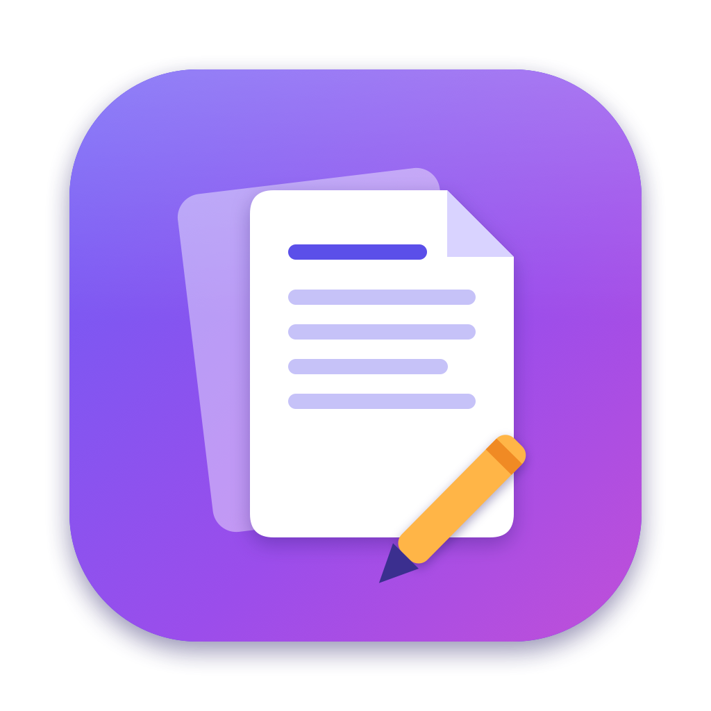

<p align="center"></p>

# PDF Studio

A private, native macOS PDF viewer and editor: edit existing text and images in
place (including Arabic), annotate, sign, fill and create forms, organize pages,
protect, OCR, compare, convert — and print straight to a USB HP LaserJet.

Everything runs locally: a SwiftUI/PDFKit app drives a Python engine
(PyMuPDF) on your Mac. Nothing is uploaded anywhere.

Based on [Sam PDF Studio](https://github.com/wassermanproductions/sam-pdf-studio)
by Sam Wasserman (Apache-2.0) — see [NOTICE](NOTICE).

## Features

| Area | What you can do |
|---|---|
| **Edit** | Click a paragraph and type — same font, size and color; move/resize blocks; Arabic and right-to-left text shaped correctly. Select an existing image to move, resize (handles), rotate, replace, extract or delete it — only that placement changes. Add text, images and links. Redact. |
| **Annotate & review** | Highlight / underline / strike, notes, text boxes, signatures, review marks (strikeout, squiggly, insert, replace), comments list in the sidebar. |
| **Forms** | Fill forms; create text, paragraph, checkbox, radio, dropdown, list and signature fields by dragging on the page; **Auto-Detect** blanks (`Name: ____`, boxes, checkboxes) like "Prepare Form". |
| **Pages** | Thumbnail grid: select, drag to reorder, rotate, insert, copy/paste, extract, delete; merge files; page numbers; uniform page size; split by ranges, every N pages, bookmarks or file size. |
| **Stamp** | Watermarks (text or image, opacity, rotation, behind/over content, Arabic), headers & footers with `{page}` `{pages}` `{date}` `{title}` `{filename}`, Bates numbering. |
| **Protect** | AES-256 passwords with permissions, remove passwords, flatten annotations/forms, edit properties, remove hidden data (metadata, XMP, JavaScript, attachments…). |
| **OCR** | Apple Vision (fast, on-device, Arabic + English + 30 more) or Tesseract; adds an invisible, searchable text layer. |
| **Convert** | Word/RTF/ODT/HTML/Markdown/text/images → PDF; PDF → Word, Excel, PowerPoint, Markdown, HTML, text, images. |
| **Compare** | Word-level text diff across the whole document (robust to reflow) or visual diff for scans; side-by-side report with highlights. |
| **Navigate** | Sidebar with pages, outline, comments and full-text search; bookmark editor; zoom/page pill; ⌘K command palette; Tools hub. |
| **Print** | **Print to HP LaserJet** (copies, page range, paper, darkness, toner saver; printer status; auto-retry if the printer was asleep) or the system print dialog. |

Undo/redo walks real document versions; the original file only changes on Save.

## Build & run

Requires macOS 14+, Command Line Tools, Homebrew Python 3.13, and
`brew install ghostscript qpdf tesseract`.

```bash
source script/dev-env.sh          # SDK + venv + build dirs
./script/setup-engine.sh          # first time: creates the engine venv
./script/build_and_run.sh         # builds "PDF Studio.app" into ~/Builds/PDFStudio.noindex and opens it
./script/build_and_run.sh install # builds and replaces /Applications/PDF Studio.app
```

> The macOS 27 SDK implements SwiftUI `@State` as a macro whose plugin ships
> only with full Xcode, so Command Line Tools builds use the 26.5 SDK
> (`script/dev-env.sh` sets `SDKROOT`).

## Printing to the HP LaserJet

The app hands jobs to [hp-laserjet-mac-driver](https://gitlab.com/pauyedin/hp-laserjet-mac-driver)
(installed separately): it writes the PDF plus a `job-<ts>.opts` sidecar into
`~/HP-LaserJet-spool/`, the driver's launchd watcher prints it, and the app
follows `watcher.log` to report the result.

## Architecture

- `Sources/SamPDFStudio/` — SwiftUI app. `Design/` (theme tokens and components),
  `Views/Shell/` (toolbar, sidebar, welcome, tools hub, command palette),
  `Views/Canvas/` (on-page image editing), `Features/<Area>/` (one sheet per tool,
  routed by `Features/ToolSheetHost.swift`, catalogued in `Features/ToolCatalog.swift`),
  `Stores/AppStore+<Feature>.swift` and `Services/PDFEngineClient+<Feature>.swift`.
- `Engine/pdf_engine.py` — core engine CLI (one JSON reply per command).
  `Engine/ext/*.py` — feature modules registered via `register(subparsers, api)`.
  Text arguments are NFC-normalized (the app passes them decomposed).
- Engine coordinates: points from the top-left of the page's crop box.

## QA

```bash
./script/qa.sh                    # build + every engine/UI-invariant suite
```

QA builds (`defaults write local.pdfstudio.app PDFStudioQA -bool true`) also
listen for window-snapshot requests (`script/snap.sh out.png`) and log every
engine invocation to `~/Library/Logs/PDFStudio/engine.log`.

## License

Apache License 2.0 — see [LICENSE](LICENSE) and [NOTICE](NOTICE).
