<h1 align="center">Folio PDF: Free, Open-Source PDF Editor for Mac</h1>

<p align="center">
  <b>Edit the text and images already in any PDF, in English or Arabic. Sign, fill forms, OCR, organize, convert and print.</b><br>
  A native macOS app that keeps your documents on your Mac. Free and open source, with no account and no subscription. An Adobe Acrobat alternative.
</p>

<p align="center">
  <a href="https://github.com/mhatem5351/folio-pdf-mac/releases/latest"></a>
  <a href="https://github.com/mhatem5351/folio-pdf-mac/releases"></a>
  <a href="LICENSE"></a>
  
  
  
  <a href="https://github.com/mhatem5351/folio-pdf-mac/actions/workflows/ci.yml"></a>
</p>

<p align="center">
  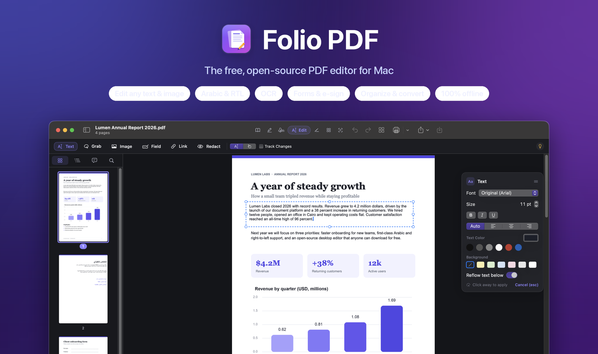
</p>

<p align="center">
  <a href="#download"><b>Download</b></a> ·
  <a href="#features"><b>Features</b></a> ·
  <a href="#screenshots"><b>Screenshots</b></a> ·
  <a href="#build-from-source"><b>Build from source</b></a> ·
  <a href="#faq"><b>FAQ</b></a>
</p>

---

## Why Folio PDF?

Most PDF editors for Mac that can **change the words already on the page** cost a monthly subscription, and some upload your files to a server. Folio PDF does the same job for free, and everything happens on your Mac.

- ✍️ **Edit existing text in place.** Click a paragraph and type. Folio keeps the original font, size, color and line spacing, and the paragraphs below move down or up to make room.
- 🌍 **Arabic and right-to-left text.** Text is shaped and joined correctly, and it copies and searches in the right (logical) order. Many editors get this wrong.
- 🔒 **Private.** Folio needs no account, sends no telemetry and uploads nothing. OCR runs on your Mac with Apple Vision.
- 📦 **Ready to use.** The app is a single download with its PDF engine built in. You don't need to install Python, Homebrew or anything else.
- 🆓 **Free and open source** under the Apache-2.0 license.

## Download

**[⬇︎ Download Folio PDF for Mac (Apple Silicon, .dmg)](https://github.com/mhatem5351/folio-pdf-mac/releases/latest)**

1. Open the `.dmg` and drag **Folio PDF** into **Applications**.
2. The first time you open it, macOS may say it *"cannot verify the developer"*, because the app is free and not notarized by Apple. To open it anyway, do one of the following:
   - Open **System Settings → Privacy & Security** and click **Open Anyway**.
   - Or run this once in Terminal:
     ```bash
     xattr -dr com.apple.quarantine "/Applications/Folio PDF.app"
     ```

**One-line install** (downloads the latest release, checks its checksum and installs it):

```bash
curl -fsSL https://raw.githubusercontent.com/mhatem5351/folio-pdf-mac/main/install.sh | bash
```

> Requires macOS 14 Sonoma or later on Apple Silicon (M1 or newer). Intel Macs can [build from source](#build-from-source).

## Features

| | |
|---|---|
| ✍️ **Edit text** | Click any paragraph and edit it like a word processor. The original font, size, color and **line spacing** are kept. **Reflow** moves the text below down or up when a paragraph grows or shrinks. You can also move and resize text blocks, add new text and links, and redact. |
| 🌍 **Arabic & RTL** | Arabic is shaped with HarfBuzz and written with an `/ActualText` layer, so copy, paste, search and text export come out in logical order. Text direction is detected automatically, with right alignment for Arabic. |
| 🖼️ **Edit images** | Select an image on the page to move it, resize it with handles, rotate, replace, extract or delete it. Only that image changes; the rest of the page stays as it was. |
| 🔎 **OCR** | Apple Vision OCR runs on your Mac and supports Arabic, English and more than 30 other languages. It adds an invisible, searchable text layer to scans. Folio prepares Vision as soon as it detects a scanned document. Tesseract is also supported. |
| 📝 **Forms** | Fill in forms. **Auto-detect** finds blanks (`Name: ____`), boxes and checkboxes and turns them into fields. You can also draw text, checkbox, radio, dropdown, list and signature fields yourself. |
| ✒️ **Sign & annotate** | Signatures, highlights, underline, strikethrough, notes, text boxes and review marks, plus a comments list in the sidebar. |
| 📑 **Organize pages** | A thumbnail grid where you can drag to reorder pages, and rotate, insert, copy, paste, extract or delete them. You can also merge files, add page numbers, make page sizes uniform and split a file by ranges, every N pages, bookmarks or file size. |
| 💧 **Stamp** | Text or image watermarks, including Arabic, with opacity and rotation. Headers and footers with `{page}`, `{pages}`, `{date}` and `{title}` fields. Bates numbering. |
| 🛡️ **Protect** | AES-256 passwords with permissions. You can also remove passwords, flatten annotations and forms, edit document properties, and remove hidden data such as metadata, XMP, JavaScript and attachments. |
| 🔄 **Convert** | Create PDFs from Word, RTF, ODT, HTML, Markdown, text and images. Export PDFs to Word, Excel, PowerPoint, Markdown, HTML, text and images. |
| ⚖️ **Compare** | Compare two versions word by word across the whole document, or visually for scans. The results appear side by side with highlights. |
| 🖨️ **Print** | The standard macOS print dialog, plus built-in **Print to HP LaserJet** for USB printers that macOS no longer supports (P1102, P1005, 1020, M1005). It needs the [companion driver](https://github.com/mhatem5351/hp-laserjet-macos-driver). |
| ⌘ **Fast UI** | Press **⌘K** to open a command palette and find any tool by name. There's also a Tools hub and a sidebar with pages, outline, comments and full-text search. |
| 🤖 **For AI agents** | An optional [MCP server](mcp/README.md) lets Claude, Codex and other agents merge, split, redact, OCR and convert PDFs with the same engine. |

Undo and redo step through real versions of the document, and the original file only changes when you save.

## Screenshots

<p align="center">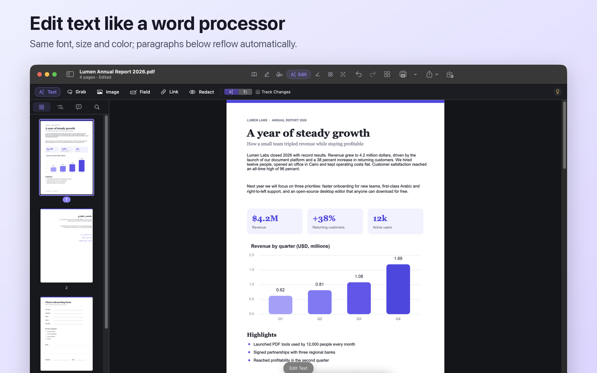</p>
<p align="center">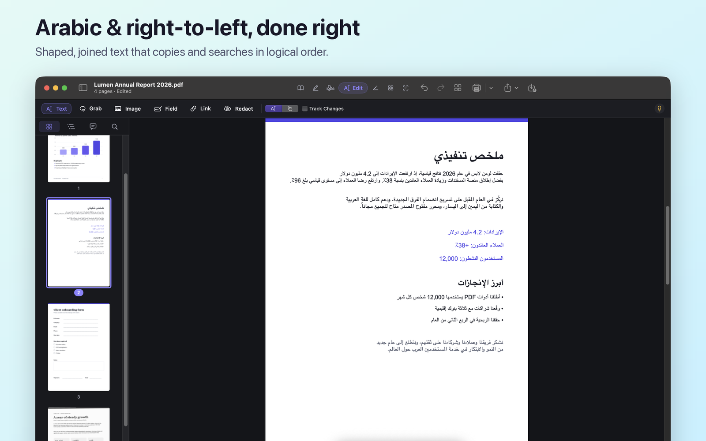</p>

<table>
  <tr>
    <td width="50%">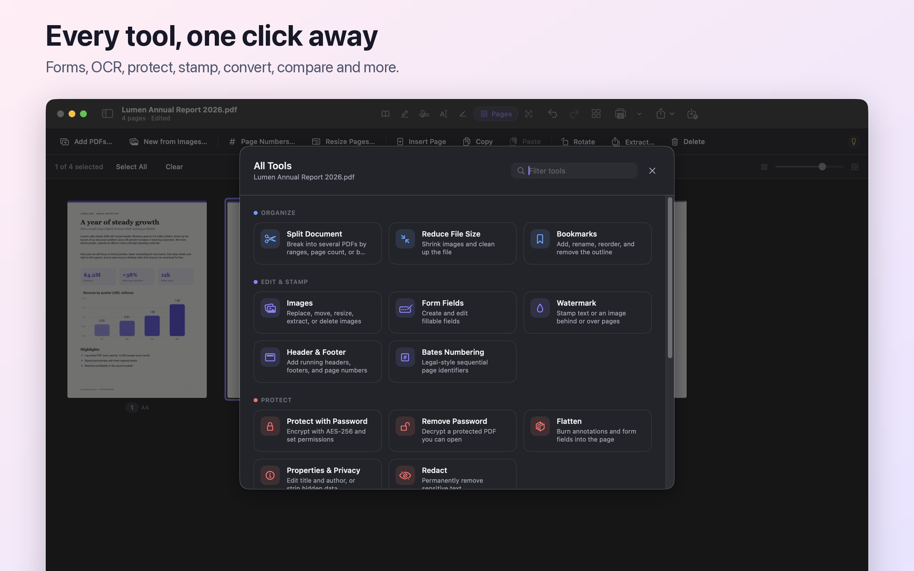</td>
    <td width="50%">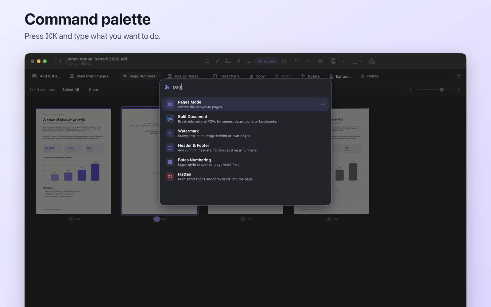</td>
  </tr>
  <tr>
    <td width="50%">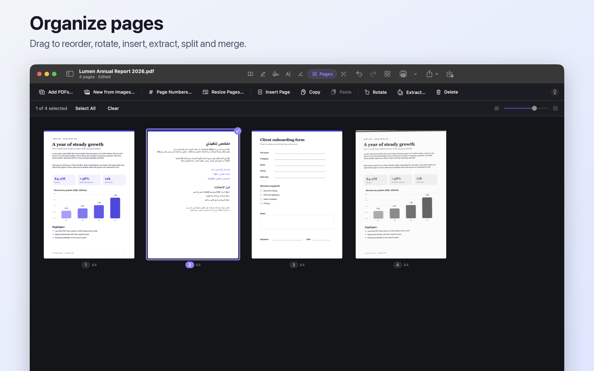</td>
    <td width="50%">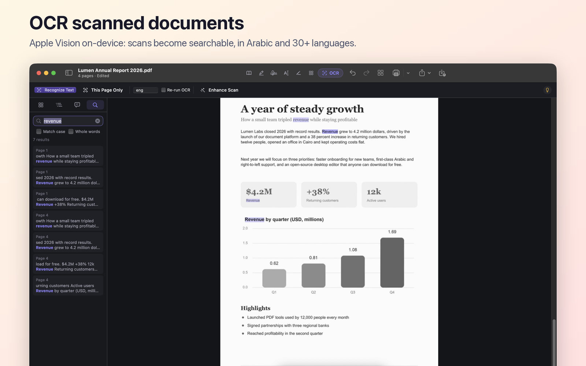</td>
  </tr>
  <tr>
    <td width="50%">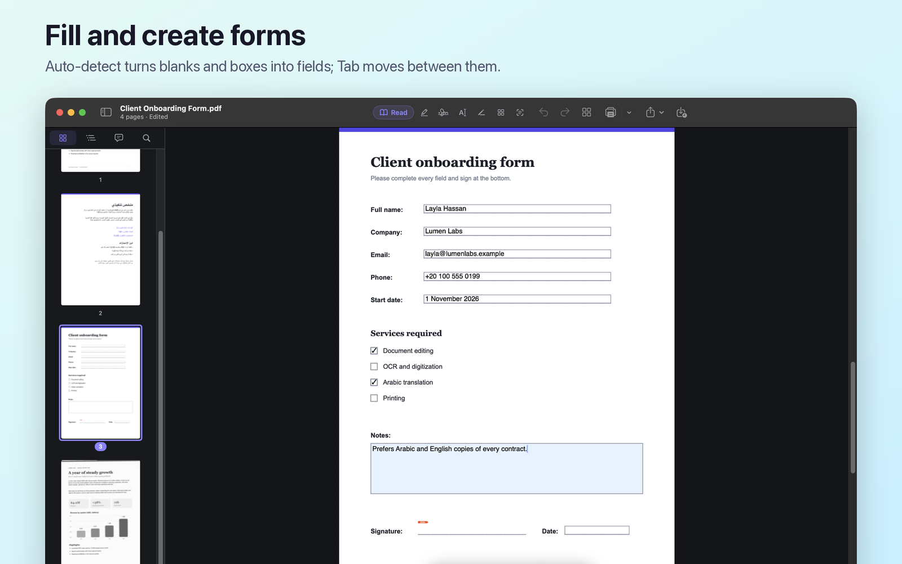</td>
    <td width="50%">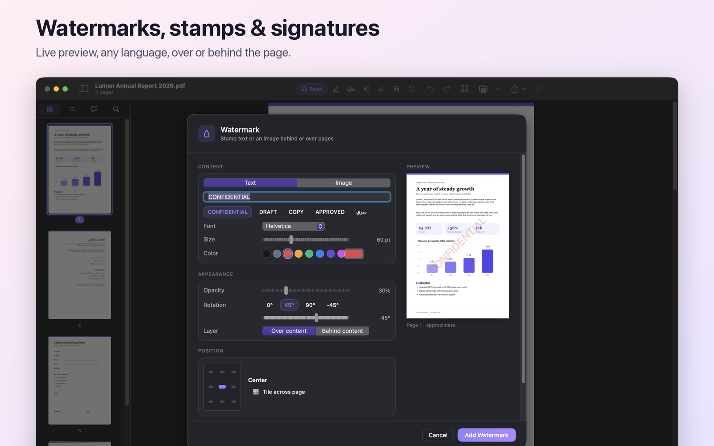</td>
  </tr>
  <tr>
    <td width="50%">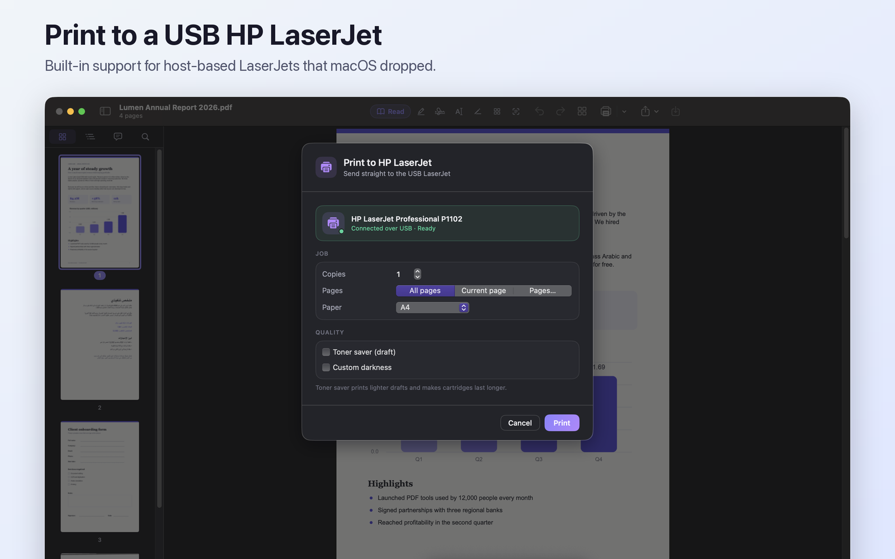</td>
    <td width="50%">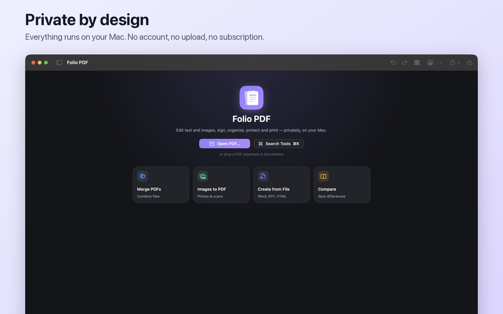</td>
  </tr>
</table>

## Build from source

You need macOS 14 or later and the Xcode Command Line Tools (`xcode-select --install`). For development you also need Python 3.13 (`brew install python@3.13`). OCR with Tesseract and compression additionally need `brew install ghostscript qpdf tesseract`.

```bash
git clone https://github.com/mhatem5351/folio-pdf-mac.git
cd folio-pdf-mac
source script/dev-env.sh            # SDK, engine venv and build folders
./script/setup-engine.sh            # first time only: creates the engine venv
./script/build_and_run.sh           # builds "Folio PDF.app" and opens it
./script/build_and_run.sh install   # builds and installs it into /Applications
```

To build the downloadable, self-contained app (it bundles a standalone CPython with every engine package):

```bash
./script/package_release.sh 2.0.0   # → dist/FolioPDF-2.0.0-arm64.dmg
```

> **Note:** with only the Command Line Tools installed, the macOS 27 SDK can't expand SwiftUI's `@State` macro (the macro plugin ships with Xcode). `script/dev-env.sh` therefore builds against the 26.5 SDK. Builds with full Xcode work with either SDK.

### Tests

```bash
./script/qa.sh                      # builds, then runs every engine and UI-invariant suite
```

The suites in `Tests/` cover editing and reflow, line spacing, Arabic shaping and extraction, OCR layers, forms, stamps, conversion and a matrix of more than 100 engine operations.

## How it works

```
SwiftUI + PDFKit app  ──JSON over a subprocess──▶  Python engine (PyMuPDF, HarfBuzz, pypdf …)
 viewing, editing UI,                                text editing and reflow, RTL shaping,
 Apple Vision OCR, printing                          forms, stamps, convert, compare
```

- `Sources/FolioPDF/`: the app. `Design/` holds theme tokens and components, `Views/` the shell, canvas and preview, `Features/<Area>/` one sheet per tool, plus the `Stores/` and `Services/` layers.
- `Engine/pdf_engine.py` and `Engine/ext/*.py`: the engine command-line tool. Each command prints one JSON reply.
- `mcp/`: the optional MCP bridge for AI agents.

## FAQ

**Is Folio PDF really free?** Yes. It is open source under Apache-2.0, with no paid tier, no watermark on exports and no account.

**Can it edit text in a scanned PDF?** Run **OCR** first. It adds a searchable text layer, and then you can search, select and copy the text. For full rewrites of a scanned page, convert it to Word.

**Does it work offline?** Yes. Everything runs on your Mac, and the app never needs the internet.

**Why does macOS warn when I first open it?** Apple charges developers to notarize apps. Folio is ad-hoc signed, so macOS asks once. See [Download](#download) for the one-time fix, or use the one-line installer.

**Intel Mac?** Release builds are Apple Silicon only, but the source builds on Intel. See [Build from source](#build-from-source).

## Credits

Folio PDF is based on **[Sam PDF Studio](https://github.com/wassermanproductions/sam-pdf-studio)**, created by **Sam Wasserman ([wassermanproductions.com](https://wassermanproductions.com))** and licensed under Apache-2.0. Many thanks to Sam for the foundation. See [NOTICE](NOTICE).

Folio PDF adds in-place text editing with reflow and preserved line spacing, Arabic and RTL editing with logical copy order, on-device Vision OCR, form auto-detection, a redesigned interface with a command palette, HP LaserJet printing and a self-contained release build.

It is built with [PyMuPDF](https://github.com/pymupdf/PyMuPDF), [HarfBuzz](https://github.com/harfbuzz/uharfbuzz), [pypdf](https://github.com/py-pdf/pypdf), [pdf2docx](https://github.com/ArtifexSoftware/pdf2docx), [fontTools](https://github.com/fonttools/fonttools) and Apple's PDFKit and Vision. Release builds include third-party software under its own licenses (PyMuPDF/MuPDF is AGPL-3.0); see `THIRD_PARTY_NOTICES.md` inside the app.

## License

[Apache License 2.0](LICENSE). Copyright © 2026 Mohamed Hatem, and © 2026 Sam Wasserman for the original Sam PDF Studio.

<p align="center"><sub>If Folio PDF saves you a subscription, consider giving it a ⭐. It helps other Mac users find it.</sub></p>
